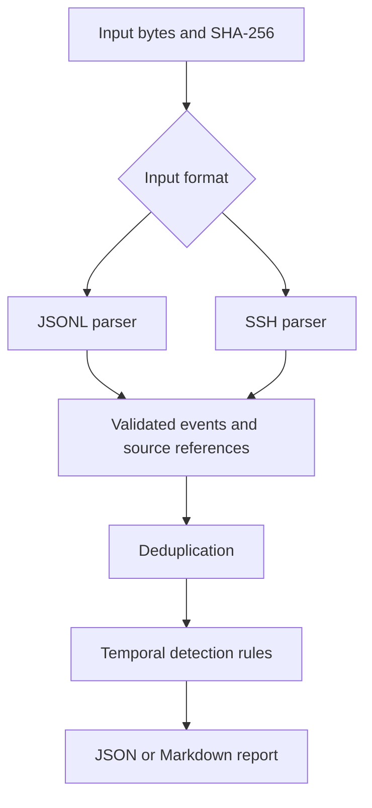

# SOC Evidence Pipeline

Explainable offline authentication detection with traceable evidence,
configurable temporal rules, and JSON or Markdown investigation reports.

An educational defensive engineering project built in Python.
The current implementation uses deterministic detection rules, not AI.

## Features

- Parse structured JSONL events and supported SSH password authentication logs.
- Validate authentication events and normalize timestamps to UTC.
- Preserve source file names and line numbers.
- Deduplicate repeated records with identical source references.
- Detect failure bursts, successful logins after failures, and multi-account failures.
- Include effective detection settings and supporting evidence in reports.
- Calculate SHA-256 over the input bytes used for analysis.
- Export reports without overwriting existing files.

## Installation

Use Python 3.12 or newer. The commands below target Linux and must be run
from the repository root.

```bash
python3 -m venv .venv
source .venv/bin/activate
python -m pip install -r requirements-dev.lock
python -m pip install --no-build-isolation --no-deps -e .
python -m pip check
```

The application has no third-party runtime dependencies.
The development dependency snapshot pins exact versions, including setuptools,
but does not include artifact hashes.

## Usage

Analyze the bundled synthetic failure burst:

```bash
soc-evidence data/synthetic/ssh-failure-burst.log --format ssh
```

Expected alert counts for this fixture with default settings:

```json
{
  "failure_burst": 1,
  "success_after_failures": 0,
  "multi_account_failures": 0
}
```

This excerpt is not the complete report. The full output also includes
input provenance, configuration and the five supporting authentication events.

Analyze a successful login following three failures:

```bash
soc-evidence data/synthetic/ssh-success-after-failures.log --format ssh
```

Expected: one `success_after_failures` alert.

Export a Markdown report:

```bash
mkdir -p reports
soc-evidence data/synthetic/ssh-failure-burst.log \
  --format ssh \
  --output-format markdown \
  --output reports/failure-burst.md
```

An existing output file is refused. Choose a new file name for another export.

Inspect available configuration options:

```bash
soc-evidence --help
```

## Architecture



See [Architecture](docs/architecture.md) for module responsibilities
and design decisions.

## Quality Checks

```bash
python -m ruff check .
python -m ruff format --check .
python -m pytest -q
```

The latest observed local run passed 169 tests.
A fresh local Python 3.14 development environment was also verified.

GitHub Actions is configured to check dependencies, formatting, linting,
tests and CLI execution on Ubuntu with Python 3.12 and 3.14.
Remote CI results remain pending until the workflow runs on GitHub.

## Evaluation

See [Detection Evaluation](docs/evaluation.md) for synthetic scenarios,
label definitions, metrics and the baseline comparison.

See [Performance Evaluation](docs/performance.md) for the benchmark method,
recorded timings and memory measurements.

Synthetic regression results do not establish real-world detection accuracy.
A legitimate sequence of password mistakes can trigger an alert.

## Security Considerations

Use only synthetic data or logs you are authorized to analyze.
Run demonstrations in isolated labs and execute the CLI without root privileges.

Logs and reports may contain sensitive authentication metadata.
Keep real inputs and generated reports outside public repositories.

SHA-256 identifies input bytes; it does not prove log authenticity.
The input file should remain stable while being read.

See [Security Considerations](SECURITY.md) for handling guidance and reporting.

## Limitations

- Analysis is offline; there is no live collection or automated response.
- SSH parsing supports a specific ISO-timestamped password authentication format.
- Unsupported or malformed input stops analysis.
- Input bytes, decoded text and parsed events are held in memory.
- Large files and dense event windows need further performance evaluation.
- Deduplication uses supplied source references, not content across copied files.
- Slow or distributed activity may remain below detection thresholds.
- Alerts require contextual investigation and do not prove compromise.
- A failed export may leave a partial output file.
- CI actions currently use major-version tags rather than immutable commit SHAs.

## Future Work

- Evaluate more diverse, independently labeled authentication scenarios.
- Measure behavior under dense event windows and larger inputs.
- Improve resource bounds and output failure handling.
- Extend supported log formats with explicit tests.
- Pin CI actions to reviewed immutable commits.

## License

Distributed under the [MIT License](LICENSE).
