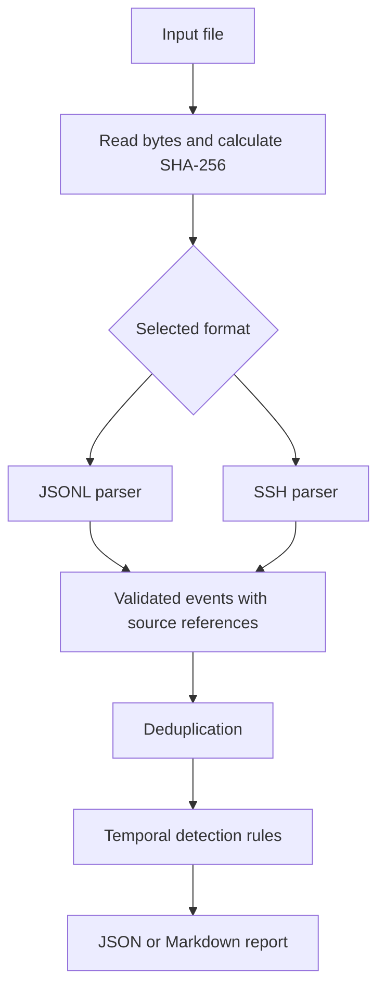

# Architecture

SOC Evidence Pipeline analyzes authorized authentication logs offline.

## Processing flow

## Module responsibilities

| Module | Responsibility |
| --- | --- |
| `cli.py` | Arguments, configuration and pipeline orchestration |
| `input_snapshot.py` | Read input bytes, calculate hash and invoke parsing |
| `parsing.py` | Validate structured JSONL events |
| `ssh_parsing.py` | Parse supported SSH password authentication lines |
| `models.py` | Validate events and source references |
| `deduplication.py` | Remove repeated records with identical source references |
| `detection.py` | Apply three configurable temporal detection rules |
| `reporting.py` | Serialize alerts and their supporting evidence |
| `markdown_reporting.py` | Render readable investigation reports |
| `exporting.py` | Create output files without overwriting existing files |

## Design decisions

- Analysis is offline and does not modify the monitored system.
- Event timestamps are normalized to UTC.
- Evidence includes the source file name and line number.
- The input hash identifies the analyzed bytes; it does not prove authenticity.
- Detection uses explicit rules rather than a machine learning model.
- Invalid input stops analysis instead of producing a partial success report.
- Reports contain authentication metadata and require appropriate access control.

## Current boundaries

The input and parsed events are held in memory. Large files and dense event
windows require further performance evaluation.

SSH support covers the documented ISO-timestamped password authentication
format, not every Linux authentication log format.

An alert indicates a pattern requiring investigation, not proof of compromise.
